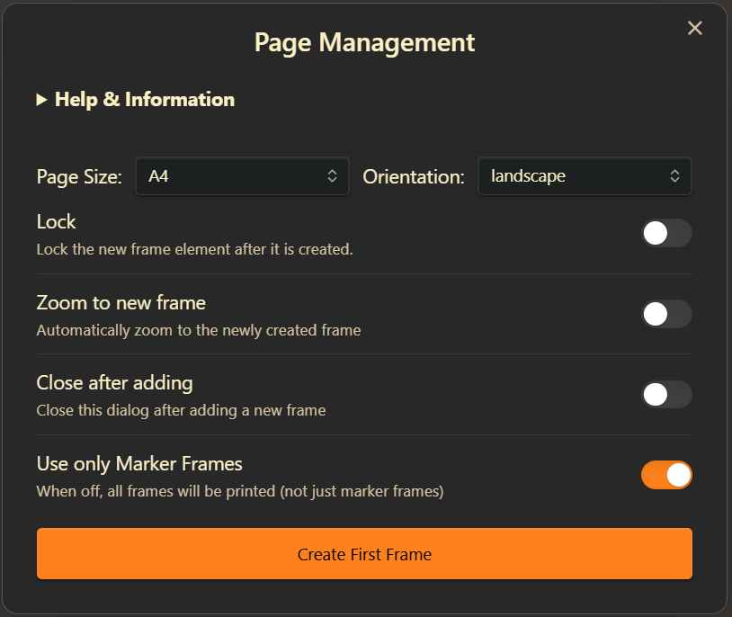
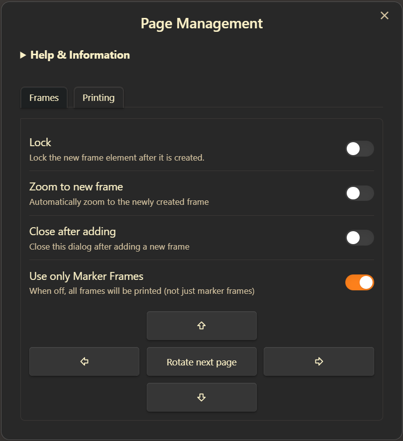

/*
# Printable Layout Wizard

Export Excalidraw drawings as printable PDF pages. Define page areas with marker frames, add matching pages in any direction, rotate the next page, and choose page size, orientation, margins, locking, zoom, and empty-page handling.

In **Printing → Pages**, leave the field blank to print all pages or enter a selection such as `1, 3-5, 9-`. This prints page 1, pages 3 through 5, and page 9 through the end. Commas and semicolons separate ranges. Pages retain alphabetical frame order; overlapping ranges print each page once. The preview labels each page with its number and frame name. Numbers refer to these previews **before** empty pages are skipped, and only include marker frames when that option is enabled. A range beyond the end selects no pages; an invalid range displays an error without exporting.

The print preview dims excluded pages and shows the chosen margins. The count next to **Export to PDF** updates as you change the range or empty-page option. Previews refresh when the drawing changes; use the refresh button to rebuild them manually.

Frames define print areas; content outside them is excluded. Frame borders and titles do not print. Keep frames the same size and orientation for a uniform PDF. Custom frames retain their size. Existing script preferences are preserved; page selection resets when you close the dialog. The selected Frames or Printing tab is remembered per file until Obsidian restarts.

Requires Excalidraw 2.27.0 or newer. PDF export uses the plugin's existing PDF service (Excalidraw Extras on desktop).

[Modular source and authoring instructions](https://github.com/zsviczian/ea-scripts/tree/main/src/scripts/printable-layout-wizard)






If you find this script helpful, consider [buying me a coffee](https://ko-fi.com/zsolt).

Build version: 2026-11-04T07:18:10.636Z

```javascript
*/

// Script bundle
/* EA Script — printable-layout-wizard | ea-scripts v1.0.0 */
(() => {
  // src/sharedUtils/i18n.ts
  function interpolateTranslation(template, params = {}) {
    return Object.entries(params).reduce(
      (result, [key, value]) => result.split(`{${key}}`).join(String(value)),
      template
    );
  }
  function createTranslator(requestedLocale, catalogs, fallbackLocale = "en") {
    const locale = requestedLocale.toLowerCase().replaceAll("_", "-");
    const baseLocale = locale.split("-")[0] ?? locale;
    return (key, params = {}) => {
      const template = catalogs[locale]?.[key] ?? catalogs[baseLocale]?.[key] ?? catalogs[fallbackLocale]?.[key] ?? key;
      return interpolateTranslation(template, params);
    };
  }

  // src/scripts/printable-layout-wizard/lang/en.ts
  var en = {
    preview: "Print preview",
    previewPage: "{number}: {name}",
    emptyPage: "Empty page",
    previewFailed: "Preview unavailable",
    refreshPreview: "Refresh previews",
    printCount: "{count} pages",
    printCountOne: "1 page",
    requiresVersion: "Please update Excalidraw to version {version} or newer.",
    noView: "Open an Excalidraw drawing first.",
    title: "Page management",
    help: "Help & information",
    helpText: '\n**Easily split your Excalidraw drawing into printable pages!**\n\nIf you find this script helpful, consider [buying me a coffee](https://ko-fi.com/zsolt). Thank you.\n\n---\n\n### How it works\n\n- **Define Pages:** Use frames to mark out each page area in your drawing. You can create the first frame with this script (choose a standard size or orientation), or draw your own frame for a custom page size.\n- **Add More Pages:** Select a frame, then use the arrow buttons to add new frames next to it. All new frames will match the size of the selected one.\n- **Rename Frames:** You can rename frames as you like. When exporting to PDF, pages will be ordered alphabetically by frame name.\n\n---\n\n### Important Notes\n\n- **Same Size & Orientation:** All frames must have the same size and orientation (e.g., all A4 Portrait) to export to PDF. Excalidraw currently does not support PDFs with different-sized pages.\n- **Custom Sizes:** If you draw your own frame, the PDF will use that exact size\u2014great for custom page layouts!\n- **Margins:** If you set a margin, the page size stays the same, but your content will shrink to fit inside the printable area.\n- **No Frame Borders/Titles in Print:** Frame borders and frame titles will *not* appear in the PDF.\n- **No Frame Clipping:** The script disables frame clipping for this drawing.\n- **Templates:** You can save a template document with prearranged frames (even locked ones) for reuse.\n- **Lock Frames:** Frames only define print areas\u2014they don\'t "contain" elements. Locking frames is recommended to prevent accidental movement.\n- **Outside Content:** Anything outside the frames will *not* appear in the PDF.\n\n---\n\n### Printing\n\n- **Export to PDF:** Click the printer button to export each frame as a separate page in a PDF.\n- **Order:** Pages are numbered in alphabetical order of frame names.\n- **Pages:** Leave blank for all pages, or enter ranges such as `1, 3-5, 9-`. Numbers refer to the frame list before empty pages are skipped.\n\n---\n\n### Settings\n\nYou can also access script settings at the bottom of Excalidraw Plugin settings. The script stores your preferences for:\n- Locking new frames after creation\n- Zooming to new frames\n- Closing the dialog after adding a frame\n- Default page size and orientation\n- Print margin\n\n---\n\n**Tip:** For more on templates, see [Mastering Excalidraw Templates](https://youtu.be/jgUpYznHP9A). For referencing pages in markdown, see [Image Fragments](https://youtu.be/sjZfdqpxqsg) and [Image Block References](https://youtu.be/yZQoJg2RCKI).\n\n\n\n\n',
    frames: "Frames",
    printing: "Printing",
    lock: "Lock",
    lockHint: "Lock the new frame after it is created.",
    zoom: "Zoom to new frame",
    zoomHint: "Automatically zoom to the newly created frame.",
    close: "Close after adding",
    closeHint: "Close this dialog after adding a new frame.",
    markers: "Use only marker frames",
    markersHint: "When off, include all frames, not just marker frames.",
    pageSize: "Page size",
    orientation: "Orientation",
    portrait: "Portrait",
    landscape: "Landscape",
    createFirst: "Create first frame",
    rotate: "Rotate next page",
    up: "Add page above",
    down: "Add page below",
    left: "Add page to the left",
    right: "Add page to the right",
    margin: "Print margin",
    none: "None",
    tiny: "Tiny",
    normal: "Normal",
    printEmpty: "Print empty pages",
    printEmptyHint: "Include frames with no content in the PDF.",
    pages: "Pages",
    pagesHint: "Leave blank for all pages. Use 1, 3-5, 9-. Numbers follow alphabetical frame order, before empty pages are skipped.",
    pageList: "Pages ({count}): {names}",
    invalidRange: "Enter page numbers or ranges such as 1, 3-5, 9-. Use positive numbers and increasing ranges.",
    noPages: "No pages to print. Check the page range and empty-page setting.",
    noFrames: "No frames found to print.",
    preparing: "Preparing PDF, please wait\u2026",
    print: "Export to PDF",
    failed: "The operation could not finish. See the developer console for details.",
    viewChanged: "The drawing changed. Reopen Printable Layout Wizard and try again."
  };

  // src/scripts/printable-layout-wizard/lang/de.ts
  var de = {
    preview: "Druckvorschau",
    previewPage: "{number}: {name}",
    emptyPage: "Leere Seite",
    previewFailed: "Vorschau nicht verf\xFCgbar",
    refreshPreview: "Vorschau aktualisieren",
    printCount: "{count} Seiten",
    printCountOne: "1 Seite",
    title: "Seitenverwaltung",
    frames: "Rahmen",
    printing: "Drucken",
    pages: "Seiten",
    pagesHint: "Leer lassen f\xFCr alle Seiten. Beispiel: 1, 3-5, 9-. Nummerierung nach alphabetischer Rahmenreihenfolge, bevor leere Seiten \xFCbersprungen werden.",
    invalidRange: "Seitenzahlen oder Bereiche wie 1, 3-5, 9- eingeben. Positive Zahlen und aufsteigende Bereiche verwenden.",
    pageList: "Seiten ({count}): {names}",
    noPages: "Keine Seiten zum Drucken. Seitenbereich und Einstellung f\xFCr leere Seiten pr\xFCfen.",
    print: "Als PDF exportieren"
  };

  // src/scripts/printable-layout-wizard/lang/es.ts
  var es = {
    preview: "Vista previa",
    previewPage: "{number}: {name}",
    emptyPage: "P\xE1gina vac\xEDa",
    previewFailed: "Vista previa no disponible",
    refreshPreview: "Actualizar vistas previas",
    printCount: "{count} p\xE1ginas",
    printCountOne: "1 p\xE1gina",
    title: "Gesti\xF3n de p\xE1ginas",
    frames: "Marcos",
    printing: "Impresi\xF3n",
    pages: "P\xE1ginas",
    pagesHint: "Deja vac\xEDo para todas las p\xE1ginas. Ejemplo: 1, 3-5, 9-. Se numeran por orden alfab\xE9tico de marcos, antes de omitir p\xE1ginas vac\xEDas.",
    invalidRange: "Introduce n\xFAmeros o rangos como 1, 3-5, 9-. Usa n\xFAmeros positivos y rangos ascendentes.",
    pageList: "P\xE1ginas ({count}): {names}",
    noPages: "No hay p\xE1ginas para imprimir. Revisa el rango y la opci\xF3n de p\xE1ginas vac\xEDas.",
    print: "Exportar a PDF"
  };

  // src/scripts/printable-layout-wizard/lang/fr.ts
  var fr = {
    preview: "Aper\xE7u avant impression",
    previewPage: "{number} : {name}",
    emptyPage: "Page vide",
    previewFailed: "Aper\xE7u indisponible",
    refreshPreview: "Actualiser les aper\xE7us",
    printCount: "{count} pages",
    printCountOne: "1 page",
    title: "Gestion des pages",
    frames: "Cadres",
    printing: "Impression",
    pages: "Pages",
    pagesHint: "Laisser vide pour toutes les pages. Exemple : 1, 3-5, 9-. Num\xE9rotation par ordre alphab\xE9tique des cadres, avant de sauter les pages vides.",
    invalidRange: "Saisir des num\xE9ros ou plages comme 1, 3-5, 9-. Utiliser des nombres positifs et des plages croissantes.",
    pageList: "Pages ({count}) : {names}",
    noPages: "Aucune page \xE0 imprimer. V\xE9rifier la plage et le r\xE9glage des pages vides.",
    print: "Exporter en PDF"
  };

  // src/scripts/printable-layout-wizard/lang/ru.ts
  var ru = {
    preview: "\u041F\u0440\u0435\u0434\u043F\u0440\u043E\u0441\u043C\u043E\u0442\u0440 \u043F\u0435\u0447\u0430\u0442\u0438",
    previewPage: "{number}: {name}",
    emptyPage: "\u041F\u0443\u0441\u0442\u0430\u044F \u0441\u0442\u0440\u0430\u043D\u0438\u0446\u0430",
    previewFailed: "\u041F\u0440\u0435\u0434\u043F\u0440\u043E\u0441\u043C\u043E\u0442\u0440 \u043D\u0435\u0434\u043E\u0441\u0442\u0443\u043F\u0435\u043D",
    refreshPreview: "\u041E\u0431\u043D\u043E\u0432\u0438\u0442\u044C \u043F\u0440\u0435\u0434\u043F\u0440\u043E\u0441\u043C\u043E\u0442\u0440",
    printCount: "\u0421\u0442\u0440\u0430\u043D\u0438\u0446: {count}",
    printCountOne: "1 \u0441\u0442\u0440\u0430\u043D\u0438\u0446\u0430",
    title: "\u0423\u043F\u0440\u0430\u0432\u043B\u0435\u043D\u0438\u0435 \u0441\u0442\u0440\u0430\u043D\u0438\u0446\u0430\u043C\u0438",
    frames: "\u0420\u0430\u043C\u043A\u0438",
    printing: "\u041F\u0435\u0447\u0430\u0442\u044C",
    pages: "\u0421\u0442\u0440\u0430\u043D\u0438\u0446\u044B",
    pagesHint: "\u041E\u0441\u0442\u0430\u0432\u044C\u0442\u0435 \u043F\u0443\u0441\u0442\u044B\u043C \u0434\u043B\u044F \u0432\u0441\u0435\u0445 \u0441\u0442\u0440\u0430\u043D\u0438\u0446. \u041F\u0440\u0438\u043C\u0435\u0440: 1, 3-5, 9-. \u041D\u043E\u043C\u0435\u0440\u0430 \u0441\u043B\u0435\u0434\u0443\u044E\u0442 \u0430\u043B\u0444\u0430\u0432\u0438\u0442\u043D\u043E\u043C\u0443 \u043F\u043E\u0440\u044F\u0434\u043A\u0443 \u0440\u0430\u043C\u043E\u043A \u0434\u043E \u043F\u0440\u043E\u043F\u0443\u0441\u043A\u0430 \u043F\u0443\u0441\u0442\u044B\u0445 \u0441\u0442\u0440\u0430\u043D\u0438\u0446.",
    invalidRange: "\u0412\u0432\u0435\u0434\u0438\u0442\u0435 \u043D\u043E\u043C\u0435\u0440\u0430 \u0438\u043B\u0438 \u0434\u0438\u0430\u043F\u0430\u0437\u043E\u043D\u044B, \u043D\u0430\u043F\u0440\u0438\u043C\u0435\u0440 1, 3-5, 9-. \u0418\u0441\u043F\u043E\u043B\u044C\u0437\u0443\u0439\u0442\u0435 \u043F\u043E\u043B\u043E\u0436\u0438\u0442\u0435\u043B\u044C\u043D\u044B\u0435 \u0447\u0438\u0441\u043B\u0430 \u0438 \u0432\u043E\u0437\u0440\u0430\u0441\u0442\u0430\u044E\u0449\u0438\u0435 \u0434\u0438\u0430\u043F\u0430\u0437\u043E\u043D\u044B.",
    pageList: "\u0421\u0442\u0440\u0430\u043D\u0438\u0446\u044B ({count}): {names}",
    noPages: "\u041D\u0435\u0442 \u0441\u0442\u0440\u0430\u043D\u0438\u0446 \u0434\u043B\u044F \u043F\u0435\u0447\u0430\u0442\u0438. \u041F\u0440\u043E\u0432\u0435\u0440\u044C\u0442\u0435 \u0434\u0438\u0430\u043F\u0430\u0437\u043E\u043D \u0438 \u043D\u0430\u0441\u0442\u0440\u043E\u0439\u043A\u0443 \u043F\u0443\u0441\u0442\u044B\u0445 \u0441\u0442\u0440\u0430\u043D\u0438\u0446.",
    print: "\u042D\u043A\u0441\u043F\u043E\u0440\u0442 \u0432 PDF"
  };

  // src/scripts/printable-layout-wizard/lang/zh-cn.ts
  var zhCn = {
    preview: "\u6253\u5370\u9884\u89C8",
    previewPage: "{number}\uFF1A{name}",
    emptyPage: "\u7A7A\u767D\u9875",
    previewFailed: "\u9884\u89C8\u4E0D\u53EF\u7528",
    refreshPreview: "\u5237\u65B0\u9884\u89C8",
    printCount: "{count} \u9875",
    printCountOne: "1 \u9875",
    title: "\u9875\u9762\u7BA1\u7406",
    frames: "\u6846\u67B6",
    printing: "\u6253\u5370",
    pages: "\u9875\u7801",
    pagesHint: "\u7559\u7A7A\u6253\u5370\u5168\u90E8\u9875\u9762\u3002\u4F8B\u5982\uFF1A1, 3-5, 9-\u3002\u6309\u6846\u67B6\u540D\u79F0\u7684\u5B57\u6BCD\u987A\u5E8F\u7F16\u53F7\uFF0C\u7136\u540E\u8DF3\u8FC7\u7A7A\u767D\u9875\u3002",
    invalidRange: "\u8BF7\u8F93\u5165\u9875\u7801\u6216\u8303\u56F4\uFF0C\u5982 1, 3-5, 9-\u3002\u8BF7\u4F7F\u7528\u6B63\u6574\u6570\u548C\u9012\u589E\u8303\u56F4\u3002",
    pageList: "\u9875\u9762\uFF08{count}\uFF09\uFF1A{names}",
    noPages: "\u6CA1\u6709\u53EF\u6253\u5370\u7684\u9875\u9762\u3002\u8BF7\u68C0\u67E5\u9875\u7801\u8303\u56F4\u548C\u7A7A\u767D\u9875\u8BBE\u7F6E\u3002",
    print: "\u5BFC\u51FA\u4E3A PDF"
  };

  // src/scripts/printable-layout-wizard/lang/index.ts
  function createWizardTranslator(locale) {
    const catalogs = {
      en,
      de,
      es,
      fr,
      ru,
      "zh-cn": zhCn
    };
    return createTranslator(locale, catalogs);
  }

  // src/scripts/printable-layout-wizard/frames.ts
  function getFrames(elements, markersOnly) {
    return elements.filter(
      (el) => el.type === "frame" && (!markersOnly || el.frameRole === "marker")
    ).sort((a, b) => (a.name ?? "").localeCompare(b.name ?? ""));
  }
  function nextPageName(frames) {
    return String(
      frames.reduce(
        (max, frame) => Math.max(max, Number(/(?:Page\s+)?(\d+)/i.exec(frame.name ?? "")?.[1] ?? 0)),
        0
      ) + 1
    ).padStart(2, "0");
  }
  function adjacentPage(frame, direction, rotate) {
    const width = rotate ? frame.height : frame.width;
    const height = rotate ? frame.width : frame.height;
    return {
      width,
      height,
      x: direction === "left" ? frame.x - width : direction === "right" ? frame.x + frame.width : frame.x,
      y: direction === "up" ? frame.y - height : direction === "down" ? frame.y + frame.height : frame.y
    };
  }

  // src/scripts/printable-layout-wizard/pageRanges.ts
  function parsePageRanges(value) {
    if (!value.trim()) return [];
    return value.split(/[;,]/).map((part) => {
      const match = /^\s*(\d+)\s*(?:-\s*(\d*)\s*)?$/.exec(part);
      if (!match) throw new Error("INVALID_PAGE_RANGE");
      const first = Number(match[1]);
      const last = match[2] === void 0 ? first : match[2] === "" ? Infinity : Number(match[2]);
      if (!Number.isSafeInteger(first) || first < 1 || last !== Infinity && !Number.isSafeInteger(last) || last < first)
        throw new Error("INVALID_PAGE_RANGE");
      return { first, last };
    });
  }
  function selectPages(pages, value) {
    const ranges = parsePageRanges(value);
    return pages.filter(
      (_, index) => ranges.length === 0 || ranges.some(({ first, last }) => index + 1 >= first && index + 1 <= last)
    );
  }

  // src/sharedUtils/AsyncTaskQueue.ts
  var AsyncTaskQueue = class {
    constructor(concurrency = 1) {
      this.concurrency = concurrency;
      if (!Number.isInteger(concurrency) || concurrency < 1) {
        throw new RangeError("AsyncTaskQueue concurrency must be a positive integer.");
      }
    }
    concurrency;
    generation = 0;
    activeCount = 0;
    pending = /* @__PURE__ */ new Map();
    waiting = [];
    idleResolvers = /* @__PURE__ */ new Set();
    enqueue(key, task, isRelevant = () => true) {
      const existing = this.pending.get(key);
      if (existing) return existing;
      const generation = this.generation;
      let resolveResult = () => void 0;
      let rejectResult = () => void 0;
      const result = new Promise((resolve, reject) => {
        resolveResult = resolve;
        rejectResult = reject;
      });
      this.pending.set(key, result);
      this.waiting.push({
        generation,
        isRelevant,
        task,
        resolve: resolveResult,
        reject: rejectResult
      });
      const removePending = () => {
        if (this.pending.get(key) === result) this.pending.delete(key);
        this.resolveIdleIfNeeded();
      };
      void result.then(removePending, removePending);
      this.pump();
      return result;
    }
    clear() {
      this.generation += 1;
      this.pending.clear();
      for (const waiting of this.waiting.splice(0)) waiting.resolve(void 0);
      this.resolveIdleIfNeeded();
    }
    async idle() {
      if (this.activeCount === 0 && this.waiting.length === 0) return;
      await new Promise((resolve) => this.idleResolvers.add(resolve));
    }
    pump() {
      while (this.activeCount < this.concurrency && this.waiting.length > 0) {
        const next = this.waiting.shift();
        if (!next) break;
        if (next.generation !== this.generation) {
          next.resolve(void 0);
          continue;
        }
        try {
          if (!next.isRelevant()) {
            next.resolve(void 0);
            continue;
          }
        } catch (error) {
          next.reject(error);
          continue;
        }
        this.activeCount += 1;
        void Promise.resolve().then(next.task).then(next.resolve, next.reject).finally(() => {
          this.activeCount -= 1;
          this.pump();
          this.resolveIdleIfNeeded();
        });
      }
      this.resolveIdleIfNeeded();
    }
    resolveIdleIfNeeded() {
      if (this.activeCount !== 0 || this.waiting.length !== 0) return;
      for (const resolve of this.idleResolvers) resolve();
      this.idleResolvers.clear();
    }
  };

  // src/sharedUtils/ByteBudgetLruCache.ts
  var ByteBudgetLruCache = class {
    constructor(maximumSize, dispose) {
      this.maximumSize = maximumSize;
      this.dispose = dispose;
    }
    maximumSize;
    dispose;
    values = /* @__PURE__ */ new Map();
    totalSize = 0;
    get size() {
      return this.totalSize;
    }
    get(key) {
      const entry = this.values.get(key);
      if (!entry) return void 0;
      this.values.delete(key);
      this.values.set(key, entry);
      return entry.value;
    }
    set(key, value, size) {
      this.delete(key);
      const normalizedSize = Math.max(0, Math.trunc(size));
      this.values.set(key, { value, size: normalizedSize });
      this.totalSize += normalizedSize;
      while (this.totalSize > this.maximumSize && this.values.size > 1) {
        const oldest = this.values.keys().next().value;
        if (oldest === void 0) break;
        this.delete(oldest);
      }
    }
    delete(key) {
      const entry = this.values.get(key);
      if (!entry) return false;
      this.values.delete(key);
      this.totalSize -= entry.size;
      this.dispose?.(entry.value);
      return true;
    }
    clear() {
      for (const entry of this.values.values()) this.dispose?.(entry.value);
      this.values.clear();
      this.totalSize = 0;
    }
  };

  // src/sharedUtils/previewUtils.ts
  var elementFingerprintCache = /* @__PURE__ */ new WeakMap();
  function cloneWithoutMetadata(element) {
    const copy = { ...element };
    const customData = copy.customData;
    if (typeof customData === "object" && customData !== null && !Array.isArray(customData)) {
      const visualCustomData = { ...customData };
      delete visualCustomData.slideshow;
      if (Object.keys(visualCustomData).length === 0) delete copy.customData;
      else copy.customData = visualCustomData;
    }
    delete copy.version;
    delete copy.versionNonce;
    delete copy.updated;
    if (copy.type === "frame") delete copy.name;
    return copy;
  }
  function getSceneVisualFingerprint(elements) {
    return `[${elements.map((element) => {
      const raw = element;
      const cacheKey = element;
      if (raw.version === void 0 && raw.versionNonce === void 0) {
        return JSON.stringify(cloneWithoutMetadata(element));
      }
      const cached = elementFingerprintCache.get(cacheKey);
      if (cached && cached.version === raw.version && cached.versionNonce === raw.versionNonce) {
        return cached.value;
      }
      const value = JSON.stringify(cloneWithoutMetadata(element));
      elementFingerprintCache.set(cacheKey, {
        version: raw.version,
        versionNonce: raw.versionNonce,
        value
      });
      return value;
    }).join(",")}]`;
  }
  function exportAreaPreviewPNG(ea2, options) {
    const scale = Math.min(2, Math.max(options.targetWidth / Math.max(options.area.width, 1), 0.01));
    return ea2.createViewPNG({
      withBackground: true,
      theme: options.theme,
      frameRendering: { enabled: true, name: false, outline: false, clip: false },
      padding: 0,
      selectedOnly: false,
      embedScene: false,
      elementsOverride: options.elements,
      exportArea: options.area,
      scale
    });
  }

  // src/scripts/printable-layout-wizard/PagePreviewService.ts
  var PagePreviewService = class {
    constructor(ea2, api) {
      this.ea = ea2;
      this.api = api;
    }
    ea;
    api;
    queue = new AsyncTaskQueue(2);
    cache = new ByteBudgetLruCache(
      32 * 1024 * 1024,
      (preview) => URL.revokeObjectURL(preview.objectUrl)
    );
    generation = 0;
    /** Invalidates pending work without losing reusable thumbnails. */
    cancelPending() {
      this.generation++;
      this.queue.clear();
    }
    /** Releases URLs and makes in-flight exports unable to publish after close. */
    clear() {
      this.cancelPending();
      this.cache.clear();
    }
    /** Exports just the frame's crop; overlapping/outside scene edits do not invalidate other pages. */
    async get(frame) {
      const area = { x: frame.x, y: frame.y, width: frame.width, height: frame.height };
      const elements = this.ea.getElementsIntersectionArea(this.ea.getViewElements(), area, {
        includeBoundElements: true
      });
      const state = this.api.getAppState();
      const backgroundColor = state.viewBackgroundColor ?? "#ffffff";
      const key = [
        state.theme,
        backgroundColor,
        area.x,
        area.y,
        area.width,
        area.height,
        getSceneVisualFingerprint(elements)
      ].join("|");
      const cached = this.cache.get(key);
      if (cached) return cached;
      const generation = this.generation;
      return this.queue.enqueue(
        key,
        async () => {
          if (generation !== this.generation) return void 0;
          const blob = await exportAreaPreviewPNG(this.ea, {
            elements,
            area,
            targetWidth: 360,
            theme: state.theme
          });
          if (generation !== this.generation) return void 0;
          const preview = { objectUrl: URL.createObjectURL(blob), backgroundColor };
          this.cache.set(key, preview, blob.size);
          return preview;
        },
        () => generation === this.generation
      );
    }
  };

  // src/scripts/printable-layout-wizard/printPages.ts
  function describePrintPages(ea2, scene, markersOnly) {
    const frames = getFrames(scene, markersOnly);
    const content = scene.filter((el) => el.type !== "frame");
    const emptyIds = new Set(
      frames.filter((frame) => ea2.getElementsInArea(content, frame).length === 0).map((frame) => frame.id)
    );
    return { frames, emptyIds };
  }
  function selectPrintablePages(pages, ranges, printEmpty) {
    return selectPages(pages.frames, ranges).filter(
      (frame) => printEmpty || !pages.emptyIds.has(frame.id)
    );
  }

  // src/scripts/printable-layout-wizard/PagePreviewPanel.ts
  var PagePreviewPanel = class {
    constructor(options) {
      this.options = options;
      this.grid = options.host.createDiv({
        cls: "printable-layout-previews",
        attr: { role: "list", "aria-label": options.t("preview") }
      });
      this.grid.setCssStyles({
        display: "grid",
        gridTemplateColumns: "repeat(auto-fill, minmax(min(100%, 140px), 1fr))",
        gap: "12px",
        maxHeight: "min(260px, 32vh)",
        overflowY: "auto",
        padding: "4px"
      });
      this.refresh();
      let previous = options.ea.getViewElements();
      let previousTheme = options.api.getAppState().theme;
      let previousBackground = options.api.getAppState().viewBackgroundColor;
      this.unsubscribe = options.api.onChange((elements, state) => {
        if (elements.length === previous.length && elements.every((el, i) => el === previous[i]) && state.theme === previousTheme && state.viewBackgroundColor === previousBackground)
          return;
        previous = elements;
        previousTheme = state.theme;
        previousBackground = state.viewBackgroundColor;
        if (this.timer !== void 0) window.clearTimeout(this.timer);
        this.timer = window.setTimeout(() => {
          this.timer = void 0;
          if (!this.closed) this.refresh();
        }, 120);
      });
    }
    options;
    pages = { frames: [], emptyIds: /* @__PURE__ */ new Set() };
    cards = [];
    observer;
    unsubscribe;
    timer;
    generation = 0;
    closed = false;
    ranges = "";
    printEmpty = false;
    margin = 0;
    grid;
    /** Updates inclusion without decoding or rebuilding any thumbnail. */
    setSelection(ranges, printEmpty) {
      this.ranges = ranges;
      this.printEmpty = printEmpty;
      this.updateSelection();
    }
    /** Shows the same content inset used by PDF fit-to-page margins, without new PNG exports. */
    setMargin(margin) {
      this.margin = margin;
      for (const card of this.cards) this.applyMargin(card);
    }
    /** Reclassifies the current scene and lazily regenerates only changed, visible crops. */
    refresh() {
      this.observer?.disconnect();
      this.options.previews.cancelPending();
      const generation = ++this.generation;
      const scrollTop = this.grid.scrollTop;
      this.grid.empty();
      this.cards.length = 0;
      this.pages = describePrintPages(
        this.options.ea,
        this.options.ea.getViewElements(),
        this.options.markersOnly
      );
      for (const [index, frame] of this.pages.frames.entries()) {
        const element = this.grid.createDiv({
          cls: "printable-layout-page",
          attr: { role: "listitem" }
        });
        element.dataset.pageNumber = String(index + 1);
        element.setCssStyles({
          minWidth: "0",
          padding: "6px",
          border: "2px solid var(--background-modifier-border)",
          borderRadius: "6px"
        });
        const paper = element.createDiv();
        paper.setCssStyles({
          position: "relative",
          aspectRatio: `${frame.width} / ${frame.height}`,
          backgroundColor: "#ffffff",
          overflow: "hidden",
          border: "1px solid var(--background-modifier-border)"
        });
        const imageHost = paper.createDiv();
        imageHost.setCssStyles({
          position: "absolute",
          display: "flex",
          alignItems: "center",
          justifyContent: "center"
        });
        element.createDiv({
          text: this.options.t("previewPage", { number: index + 1, name: frame.name ?? "" }),
          cls: "setting-item-description"
        });
        if (this.pages.emptyIds.has(frame.id))
          element.createDiv({ text: this.options.t("emptyPage"), cls: "setting-item-description" });
        const card = { frame, element, paper, imageHost };
        this.cards.push(card);
        this.applyMargin(card);
      }
      this.grid.scrollTop = scrollTop;
      this.updateSelection();
      const owner = this.grid.ownerDocument.defaultView;
      if (owner?.IntersectionObserver) {
        this.observer = new owner.IntersectionObserver(
          (entries) => {
            for (const entry of entries)
              if (entry.isIntersecting) {
                this.observer?.unobserve(entry.target);
                const card = this.cards.find((candidate) => candidate.element === entry.target);
                if (card) this.renderPreview(card, generation);
              }
          },
          { root: this.grid, rootMargin: "120px" }
        );
        this.cards.forEach((card) => this.observer.observe(card.element));
      } else this.cards.slice(0, 8).forEach((card) => this.renderPreview(card, generation));
    }
    /** Detaches all activity before the panel's DOM is removed. */
    destroy() {
      this.closed = true;
      this.generation++;
      this.observer?.disconnect();
      this.unsubscribe?.();
      if (this.timer !== void 0) window.clearTimeout(this.timer);
      this.options.previews.cancelPending();
    }
    /** Matches PDF's centered contain fit inside all four physical margins. */
    applyMargin(card) {
      const horizontal = Math.min(50, this.margin / Math.max(card.frame.width, 1) * 100);
      const vertical = Math.min(50, this.margin / Math.max(card.frame.height, 1) * 100);
      card.imageHost.setCssStyles({
        left: `${horizontal}%`,
        right: `${horizontal}%`,
        top: `${vertical}%`,
        bottom: `${vertical}%`
      });
    }
    /** Mirrors the exporter selection in borders/counts; invalid input cannot reach PDF export. */
    updateSelection() {
      let selected = [];
      let invalid = false;
      try {
        selected = selectPrintablePages(this.pages, this.ranges, this.printEmpty);
      } catch {
        invalid = true;
      }
      const ids = new Set(selected.map((frame) => frame.id));
      for (const card of this.cards) {
        const included = ids.has(card.frame.id);
        card.element.dataset.included = String(included);
        card.element.setCssStyles({
          opacity: included ? "1" : "0.45",
          borderColor: included ? "var(--interactive-accent)" : "var(--background-modifier-border)"
        });
      }
      this.options.onSelection(selected.length, invalid);
    }
    /** Installs a bitmap only while this exact panel generation is still mounted. */
    renderPreview(card, generation) {
      void this.options.previews.get(card.frame).then((preview) => {
        if (!preview || this.closed || generation !== this.generation) return;
        const image = card.imageHost.createEl("img", { attr: { alt: "", "aria-hidden": "true" } });
        image.src = preview.objectUrl;
        image.decoding = "async";
        image.draggable = false;
        image.setCssStyles({
          width: "100%",
          height: "100%",
          objectFit: "contain",
          backgroundColor: preview.backgroundColor
        });
      }).catch(() => {
        if (!this.closed && generation === this.generation)
          card.imageHost.setText(this.options.t("previewFailed"));
      });
    }
  };

  // src/scripts/printable-layout-wizard/settings.ts
  var PAGE_SIZES = [
    "A0",
    "A1",
    "A2",
    "A3",
    "A4",
    "A5",
    "A6",
    "Letter",
    "Legal",
    "Tabloid",
    "Ledger"
  ];
  var MARGINS = { none: 0, tiny: 10, normal: 60 };
  var KEYS = {
    size: "Page size",
    orientation: "Page orientation",
    margin: "Print-margin",
    lock: "Lock frame after it is created",
    zoom: "Should zoom after adding page",
    close: "Should close after adding page",
    empty: "Print empty pages",
    markers: "Print only marker frames"
  };
  function loadSettings(stored) {
    const settings = structuredClone(stored);
    const defaults = {
      size: { value: "A4", valueset: PAGE_SIZES },
      orientation: { value: "portrait", valueset: ["portrait", "landscape"] },
      margin: { value: "none", valueset: Object.keys(MARGINS) },
      lock: { value: true },
      zoom: { value: false },
      close: { value: false },
      empty: { value: false },
      markers: { value: true }
    };
    for (const key of Object.keys(KEYS)) {
      const name = KEYS[key];
      settings[name] ??= defaults[key];
      if (settings[name].valueSet) {
        settings[name].valueset = settings[name].valueSet;
        delete settings[name].valueSet;
      }
    }
    return settings;
  }

  // src/scripts/printable-layout-wizard/printToPdf.ts
  async function printToPdf(ea2, options, t) {
    const view = ea2.targetView;
    const file = view?.file;
    const api = ea2.getExcalidrawAPI();
    const assertTarget = () => {
      if (!view || !file || ea2.targetView !== view || view.file !== file || ea2.getExcalidrawAPI() !== api)
        throw new Error("PRINT_VIEW_CHANGED");
    };
    assertTarget();
    const scene = ea2.getViewElements();
    const plan = describePrintPages(ea2, scene, options.markersOnly);
    const frames = plan.frames;
    if (!frames.length) {
      new ea2.obsidian.Notice(t("noFrames"));
      return;
    }
    const selected = selectPrintablePages(plan, options.ranges, options.printEmpty);
    if (!selected.length) {
      new ea2.obsidian.Notice(t("noPages"));
      return;
    }
    const notice = new ea2.obsidian.Notice(t("preparing"), 0);
    try {
      ea2.clear();
      ea2.style.opacity = 0;
      ea2.style.roughness = 0;
      ea2.style.fillStyle = "solid";
      ea2.style.backgroundColor = "black";
      ea2.style.strokeWidth = 0.01;
      for (const frame of frames) ea2.addRect(frame.x, frame.y, frame.width, frame.height);
      const elements = [...scene, ...ea2.getElements()];
      const bounds = ea2.getBoundingBox(elements);
      const svg = await ea2.createViewSVG({
        withBackground: true,
        theme: api.getAppState().theme,
        frameRendering: { enabled: false, name: false, outline: false, clip: false },
        padding: 0,
        selectedOnly: false,
        skipInliningFonts: false,
        embedScene: false,
        elementsOverride: elements
      });
      assertTarget();
      if (!svg) throw new Error("MISSING_PRINT_SVG");
      const pages = selected.map((frame) => {
        const page = svg.cloneNode(true);
        page.setAttribute(
          "viewBox",
          `${frame.x - bounds.topX} ${frame.y - bounds.topY} ${frame.width} ${frame.height}`
        );
        page.setAttribute("width", String(frame.width));
        page.setAttribute("height", String(frame.height));
        return page;
      });
      const margin = MARGINS[options.margin];
      await ea2.createPDF({
        SVG: pages,
        scale: { fitToPage: 1 },
        pageProps: {
          // Non-positive dimensions retain the original per-SVG custom-page sizing.
          dimensions: { width: 0, height: 0 },
          backgroundColor: "#ffffff",
          alignment: "center",
          margin: { left: margin, right: margin, top: margin, bottom: margin }
        },
        filename: `${file.basename}-pages.pdf`
      });
    } finally {
      ea2.clear();
      notice.hide();
    }
  }

  // src/scripts/printable-layout-wizard/WizardDialog.ts
  function openWizard(ea2, t) {
    const host = app;
    const view = ea2.targetView;
    if (host.__printableLayoutWizard?.view === view) {
      host.__printableLayoutWizard.modal.open();
      return;
    }
    host.__printableLayoutWizard?.modal.close();
    const file = view?.file;
    const api = ea2.getExcalidrawAPI();
    const modal = new ea2.FloatingModal(app);
    const settings = loadSettings(ea2.getScriptSettings());
    const originalRendering = api.getAppState().frameRendering;
    const session = window;
    const tabsByFile = session.__printableLayoutWizardTabs ??= /* @__PURE__ */ new Map();
    let tab = (file && tabsByFile.get(file.path)) ?? "frames";
    let rotate = false;
    let busy = false;
    let closed = false;
    let ranges = "";
    let writer = Promise.resolve();
    const previews = new PagePreviewService(ea2, api);
    let previewPanel;
    let helpOpen = false;
    const isCurrent = () => !closed && ea2.targetView === view && view?.file === file && ea2.getExcalidrawAPI() === api;
    const value = (key) => settings[KEYS[key]].value;
    const checked = (key) => value(key) === true;
    const frames = () => getFrames(ea2.getViewElements(), checked("markers"));
    const report = (reason) => {
      console.error("Printable Layout Wizard", reason);
      new ea2.obsidian.Notice(
        t(
          reason instanceof Error && reason.message === "PRINT_VIEW_CHANGED" ? "viewChanged" : "failed"
        )
      );
    };
    const persist = () => {
      const snapshot = structuredClone(settings);
      writer = writer.catch(report).then(() => ea2.setScriptSettings(snapshot));
      return writer;
    };
    const change = (key, newValue) => {
      settings[KEYS[key]].value = newValue;
      void persist().catch(report);
    };
    const operate = async (action) => {
      if (busy) return;
      if (!isCurrent()) {
        new ea2.obsidian.Notice(t("viewChanged"));
        return;
      }
      busy = true;
      try {
        await action();
      } catch (reason) {
        report(reason);
      } finally {
        busy = false;
        if (!closed) render();
      }
    };
    const addFrame = async (box, first) => {
      ea2.clear();
      try {
        const id = ea2.addFrame(
          box.x,
          box.y,
          box.width,
          box.height,
          first ? "01" : nextPageName(frames())
        );
        const element = ea2.getElement(id);
        element.frameRole = "marker";
        element.locked = checked("lock");
        await ea2.addElementsToView(first);
        if (!isCurrent()) return;
        const added = ea2.getViewElements().find((el) => el.id === id);
        if (added) {
          if (checked("zoom")) ea2.viewZoomToElements(true, [added]);
          else ea2.selectElementsInView([added]);
        }
        rotate = false;
        if (checked("close")) modal.close();
      } finally {
        ea2.clear();
      }
    };
    const addAdjacent = async (direction) => {
      const available = frames();
      const selected = ea2.getViewSelectedElements();
      const locked = api.getAppState().activeLockedId;
      const frame = available.find((el) => selected.some((item) => item.id === el.id) || el.id === locked) ?? available.at(-1);
      if (!frame) return;
      ea2.viewUpdateScene({ appState: { activeLockedId: null } });
      await addFrame(adjacentPage(frame, direction, rotate), false);
    };
    const button = (parent, label, action, icon) => {
      const result = parent.createEl("button", { text: label, attr: { "aria-label": label } });
      if (icon) {
        result.empty();
        const svg = ea2.obsidian.getIcon(icon);
        if (svg) result.append(svg);
      }
      result.addEventListener("click", action);
      return result;
    };
    const select = (parent, key, entries) => {
      const row = parent.createEl("label");
      row.setCssStyles({
        display: "flex",
        alignItems: "center",
        gap: "10px",
        minWidth: "0",
        flexWrap: "wrap",
        paddingBottom: key === "margin" ? "12px" : "0"
      });
      const label = t(key === "size" ? "pageSize" : key);
      row.createSpan({ text: label });
      const dropdown = row.createEl("select", { cls: "dropdown", attr: { "aria-label": label } });
      dropdown.setCssStyles({
        flex: "1 1 130px",
        width: "100%",
        minWidth: "0",
        height: "var(--input-height, 30px)"
      });
      for (const entry of entries)
        dropdown.createEl("option", {
          value: entry,
          text: key === "size" ? entry : t(entry)
        });
      dropdown.value = String(value(key));
      dropdown.addEventListener("change", () => {
        change(key, dropdown.value);
        if (key === "margin")
          previewPanel?.setMargin(MARGINS[dropdown.value] ?? 0);
      });
    };
    const toggle = (parent, key) => {
      const label = key === "empty" ? "printEmpty" : key;
      const hint = key === "empty" ? "printEmptyHint" : `${key}Hint`;
      new ea2.obsidian.Setting(parent).setName(t(label)).setDesc(t(hint)).addToggle((control) => {
        control.setValue(checked(key)).onChange((newValue) => {
          change(key, newValue);
          if (key === "markers") render();
          if (key === "empty") previewPanel?.setSelection(ranges, newValue);
        });
      });
    };
    const renderPrinting = (parent) => {
      select(parent, "margin", Object.keys(MARGINS));
      toggle(parent, "empty");
      const row = new ea2.obsidian.Setting(parent).setName(t("pages")).setDesc(t("pagesHint"));
      row.settingEl.setCssStyles({ flexWrap: "wrap", gap: "12px" });
      row.infoEl.setCssStyles({ flex: "1 1 220px", minWidth: "0" });
      row.controlEl.setCssStyles({ flex: "1 1 160px", minWidth: "0" });
      let input;
      row.addText((control) => {
        input = control.inputEl;
        input.setCssStyles({ width: "100%" });
        input.setAttribute("aria-label", t("pages"));
        control.setValue(ranges).setPlaceholder("1, 3-5, 9-").onChange((newValue) => {
          ranges = newValue;
          previewPanel?.setSelection(ranges, checked("empty"));
        });
      });
      const error = parent.createEl("p", { cls: "mod-warning", attr: { role: "alert" } });
      parent.createEl("h4", { text: t("preview") }).setCssStyles({ margin: "8px 0" });
      const gallery = parent.createDiv();
      const actions = modal.contentEl.createDiv({ cls: "printable-layout-actions" });
      actions.setCssStyles({
        display: "flex",
        alignItems: "center",
        flexWrap: "wrap",
        gap: "12px",
        flex: "0 0 auto",
        padding: "12px 10px 4px",
        borderTop: "1px solid var(--background-modifier-border)",
        backgroundColor: "var(--background-primary)"
      });
      const exportButton = button(actions, t("print"), () => {
        try {
          parsePageRanges(ranges);
        } catch {
          error.setText(t("invalidRange"));
          input.focus();
          return;
        }
        void operate(
          () => printToPdf(
            ea2,
            {
              markersOnly: checked("markers"),
              printEmpty: checked("empty"),
              ranges,
              margin: value("margin")
            },
            t
          )
        );
      });
      exportButton.addClass("mod-cta");
      exportButton.setCssStyles({ height: "40px" });
      const count = actions.createSpan({ attr: { "aria-live": "polite", role: "status" } });
      const refresh = button(
        actions,
        t("refreshPreview"),
        () => {
          previews.clear();
          previewPanel?.refresh();
        },
        "refresh-cw"
      );
      refresh.setCssStyles({ marginLeft: "auto" });
      previewPanel = new PagePreviewPanel({
        host: gallery,
        ea: ea2,
        api,
        previews,
        markersOnly: checked("markers"),
        t,
        onSelection: (total, invalid) => {
          count.setText(t(total === 1 ? "printCountOne" : "printCount", { count: total }));
          error.setText(invalid ? t("invalidRange") : "");
          input.setAttribute("aria-invalid", String(invalid));
          exportButton.disabled = invalid || total === 0;
        }
      });
      previewPanel.setSelection(ranges, checked("empty"));
      previewPanel.setMargin(MARGINS[value("margin")] ?? 0);
    };
    const render = () => {
      previewPanel?.destroy();
      previewPanel = void 0;
      component.unload();
      component.load();
      modal.contentEl.empty();
      const content = modal.contentEl.createDiv({ cls: "printable-layout-content" });
      content.setCssStyles({
        display: "flex",
        flexDirection: "column",
        gap: "15px",
        padding: "10px",
        minHeight: "0",
        overflowY: "auto",
        flex: "1 1 auto"
      });
      const help = content.createEl("details");
      help.open = helpOpen;
      help.setCssStyles({ marginBottom: "10px" });
      help.addEventListener("toggle", () => {
        helpOpen = help.open;
      });
      help.createEl("summary", { text: t("help") }).setCssStyles({ cursor: "pointer", fontWeight: "bold", marginBottom: "10px" });
      const helpBody = help.createDiv();
      helpBody.setCssStyles({
        padding: "10px",
        border: "1px solid var(--background-modifier-border)",
        borderRadius: "4px",
        maxHeight: "300px",
        overflowY: "auto"
      });
      void ea2.obsidian.MarkdownRenderer.render(
        app,
        t("helpText"),
        helpBody,
        file?.path ?? "",
        component
      ).catch(report);
      const list = frames();
      const tabs = content.createDiv({ attr: { role: "tablist" } });
      tabs.setCssStyles({
        display: "flex",
        gap: "8px",
        borderBottom: "1px solid var(--background-modifier-border)"
      });
      if (list.length) {
        for (const name of ["frames", "printing"]) {
          const control = button(tabs, t(name), () => {
            tab = name;
            if (file) tabsByFile.set(file.path, name);
            render();
          });
          control.setAttribute("role", "tab");
          control.setAttribute("aria-selected", String(tab === name));
          control.setCssStyles({
            padding: "8px 12px",
            height: "36px",
            border: "1px solid var(--background-modifier-border)",
            borderBottom: "none",
            borderRadius: "6px 6px 0 0",
            backgroundColor: tab === name ? "var(--background-secondary)" : "var(--background-primary)",
            color: "var(--text-normal)",
            marginBottom: "-1px",
            boxShadow: "none"
          });
        }
      } else {
        tab = "frames";
        tabs.remove();
      }
      const body = content.createDiv({ cls: "printable-layout-panel" });
      body.setCssStyles({
        padding: list.length ? "12px" : "0",
        border: list.length ? "1px solid var(--background-modifier-border)" : "none",
        borderRadius: "0 6px 6px 6px"
      });
      if (list.length) {
        body.setAttribute("role", "tabpanel");
        body.setAttribute("aria-label", t(tab));
      }
      if (tab === "printing") {
        renderPrinting(body);
        return;
      }
      if (!list.length) {
        const dimensions = body.createDiv({ cls: "printable-layout-dimensions" });
        dimensions.setCssStyles({
          display: "grid",
          gridTemplateColumns: "repeat(auto-fit, minmax(min(100%, 240px), 1fr))",
          gap: "10px",
          marginBottom: "10px"
        });
        select(dimensions, "size", PAGE_SIZES);
        select(dimensions, "orientation", ["portrait", "landscape"]);
      }
      for (const key of ["lock", "zoom", "close", "markers"]) toggle(body, key);
      if (!list.length) {
        const createFirstButton = button(body, t("createFirst"), () => {
          void operate(async () => {
            const size = ea2.getPagePDFDimensions(
              value("size"),
              value("orientation")
            );
            const state = api.getAppState();
            await addFrame(
              { x: (state.width - size.width) / 2, y: (state.height - size.height) / 2, ...size },
              true
            );
          });
        });
        createFirstButton.addClass("mod-cta");
        createFirstButton.setCssStyles({ width: "100%", height: "44px", marginTop: "10px" });
      } else {
        const grid = body.createDiv();
        grid.setCssStyles({
          display: "grid",
          gridTemplateColumns: "repeat(3, minmax(0, 1fr))",
          gridAutoRows: "44px",
          gap: "10px",
          marginTop: "10px"
        });
        for (const [direction, column, row] of [
          ["up", "2", "1"],
          ["left", "1", "2"],
          ["right", "3", "2"],
          ["down", "2", "3"]
        ]) {
          button(
            grid,
            t(direction),
            () => {
              void operate(() => addAdjacent(direction));
            },
            `arrow-big-${direction}`
          ).setCssStyles({
            gridColumn: column,
            gridRow: row,
            height: "100%",
            width: "100%",
            minWidth: "0",
            padding: "4px 8px",
            alignSelf: "stretch",
            display: "flex",
            alignItems: "center",
            justifyContent: "center"
          });
        }
        const rotation = button(grid, t("rotate"), () => {
          rotate = !rotate;
          render();
        });
        rotation.setCssStyles({
          gridColumn: "2",
          gridRow: "2",
          height: "100%",
          width: "100%",
          minWidth: "0",
          padding: "4px 8px",
          alignSelf: "stretch",
          whiteSpace: "normal",
          lineHeight: "1.2",
          display: "flex",
          alignItems: "center",
          justifyContent: "center"
        });
        rotation.setAttribute("aria-pressed", String(rotate));
        if (rotate) rotation.addClass("mod-cta");
      }
    };
    const component = new ea2.obsidian.Component();
    component.load();
    const unregister = ea2.registerCleanup(() => modal.close());
    modal.onClose = () => {
      if (closed) return;
      closed = true;
      unregister();
      component.unload();
      previewPanel?.destroy();
      previews.clear();
      if (host.__printableLayoutWizard?.modal === modal) delete host.__printableLayoutWizard;
      if (ea2.targetView === view && view?.file === file && ea2.getExcalidrawAPI() === api)
        ea2.viewUpdateScene({ appState: { frameRendering: originalRendering } });
    };
    host.__printableLayoutWizard = { modal, view };
    ea2.viewUpdateScene({
      appState: {
        frameRendering: {
          ...originalRendering,
          enabled: true,
          name: true,
          outline: true,
          markerEnabled: true,
          markerName: true
        }
      }
    });
    modal.titleEl.setText(t("title"));
    modal.titleEl.setCssStyles({ textAlign: "center" });
    modal.modalEl.addClass("printable-layout-wizard");
    modal.modalEl.setCssStyles({
      display: "flex",
      flexDirection: "column",
      maxHeight: "calc(100vh - 32px)"
    });
    modal.contentEl.setCssStyles({
      display: "flex",
      flexDirection: "column",
      minHeight: "0",
      overflow: "hidden"
    });
    void persist().catch(report);
    render();
    modal.open();
  }

  // src/scripts/printable-layout-wizard/run.ts
  function runWizard(ea2) {
    const t = createWizardTranslator(ea2.obsidian.moment.locale());
    if (!ea2.verifyMinimumPluginVersion("2.27.0")) {
      new ea2.obsidian.Notice(t("requiresVersion", { version: "2.27.0" }));
      return;
    }
    if (!ea2.targetView?.file || !ea2.getExcalidrawAPI()) {
      new ea2.obsidian.Notice(t("noView"));
      return;
    }
    openWizard(ea2, t);
  }

  // src/scripts/printable-layout-wizard/main.ts
  runWizard(ea);
})();

/* end of bundle */
